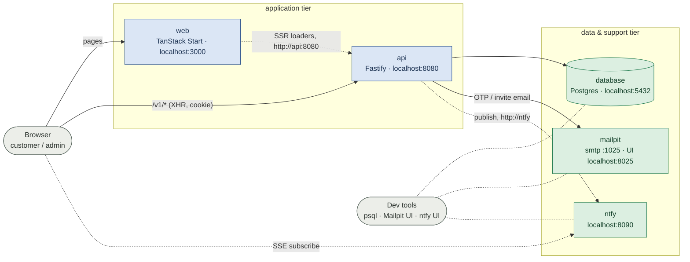
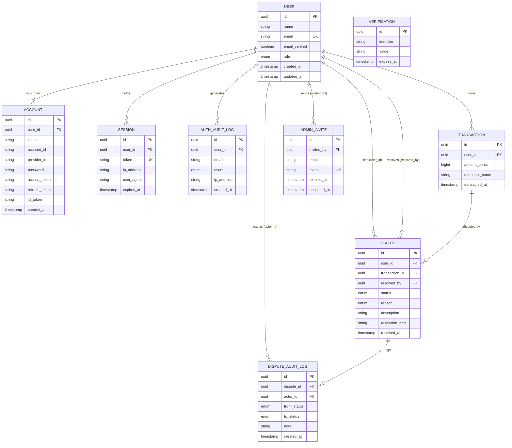

# Infrastructure

How the system connects end to end: container topology, data model, one real request/notification flow, and the target cloud/k8s shape beyond this repo. *Why*: `docs/progress-and-decisions.md` (numbers referenced inline). User-facing flows: `docs/user-stories.md`. Request-level backend behavior (stateless API, rate limiting, idempotency, health endpoints): `docs/backend-service.md`. Production deploy: `docs/production-runbook.md`.

## Container topology

`docker compose up -d` starts five containers in one compose project (`transaction-dispute-portal`). Each publishes its own `localhost` port; there is no reverse proxy (`docs/progress-and-decisions.md` #65).



Two paths reach `api`/`ntfy` two different ways:

- **`web` → `api`.** The browser calls `http://localhost:8080` (`VITE_API_URL`). The session cookie travels because `localhost:3000` and `localhost:8080` are same-site, and CORS allows `http://localhost:3000`. TanStack Start's SSR loaders inside the `web` container call `http://api:8080` (`SERVER_API_URL`) over the compose network instead, forwarding the caller's cookie.
- **`api` → `ntfy`.** `api` publishes container-to-container (`NTFY_URL=http://ntfy`). The browser subscribes over SSE at `http://localhost:8090` (`VITE_NTFY_URL`).

## Data model

Nine tables: four Better Auth's own (`user`, `account`, `session`, `verification`, plus `auth_audit_log` wrapping login events — `docs/progress-and-decisions.md` #21/#37), four the product's (`transaction`, `dispute`, `dispute_audit_log`, `admin_invite` — `docs/progress-and-decisions.md` #16/#40/#41). `dispute` has two FKs to `user`: filer (`user_id`) and closer (`resolved_by`, nullable until resolved).



`VERIFICATION` has no FK — Better Auth keys it by `identifier` (the OTP's target email), not `user_id`, since the account may not exist yet. Two constraints are partial unique indexes, not plain `UK` columns, both enforced in Postgres, not app code: `dispute` allows only one row per `transaction_id` while `status` is `SUBMITTED`/`UNDER_REVIEW` (`docs/progress-and-decisions.md` #40); `admin_invite` allows only one row per `email` while `accepted_at` is null.

## Request flow: submit → review → resolve → notify

One flow through the topology above, chosen for the parts that are easy to get wrong: the guarded writes (`docs/progress-and-decisions.md` #4/#41) and the publish/subscribe split for `ntfy`.

```mermaid
sequenceDiagram
    participant C as Customer browser
    participant A as api (Fastify)
    participant D as database (Postgres)
    participant N as ntfy
    participant Ad as Admin browser

    Note over C,N: Customer's browser holds an open SSE connection to ntfy's dispute-updates-&lt;userId&gt; topic

    C->>A: POST /v1/disputes
    A->>D: INSERT (partial unique index: one open dispute per transaction, #40)
    A-->>C: 201, dispute SUBMITTED

    Ad->>A: POST /v1/admin/disputes/:id/review
    A->>D: UPDATE … WHERE status='SUBMITTED'
    A-->>Ad: 200, UNDER_REVIEW
    A->>N: publish "under review"
    N--)C: SSE frame → toast

    Ad->>A: POST /v1/admin/disputes/:id/resolve
    A->>D: UPDATE … WHERE status='UNDER_REVIEW'
    A-->>Ad: 200, RESOLVED
    A->>N: publish "resolved"
    N--)C: SSE frame → toast
```

The two `UPDATE … WHERE` steps are load-bearing: the "from" status sits in the `WHERE` clause, not a prior read, so a concurrent second call matches nothing and gets `409` instead of double-writing or double-publishing.

## Production target (documented, not built)

Nothing below is deployed; the step-by-step, including k8s manifests, is `docs/production-runbook.md`.

| Area | Target | Why |
| --- | --- | --- |
| Production DB | Managed Postgres (RDS/Aurora Multi-AZ or Azure equivalent) | Automated failover + backups; RTO/RPO tradeoff |
| Read replica | For the historic-disputes read path | Once write/read ratio justifies it — ties to the indexing story above |
| Load balancing | ALB/API Gateway → ECS/Fargate or k8s Ingress in front of the stateless API | Meaningful only *because* the API is stateless; also the stable domain the frontend is built against, so infra can move behind it without invalidating an already-built client bundle (`docs/production-runbook.md` §3) |
| Event durability | Move the status-change event to SQS/EventBridge | Today it's in-process/simulated; production shouldn't let a notification-consumer failure touch the API request path |
| Session-lookup cost | Short-TTL cache on the session read, or Better Auth's cookie-cache/JWT session mode | The load test (`docs/progress-and-decisions.md` #48) shows the DB-backed session check, not Postgres or Fastify, is the authenticated-route ceiling — mitigate the read, don't move state back into the process |
