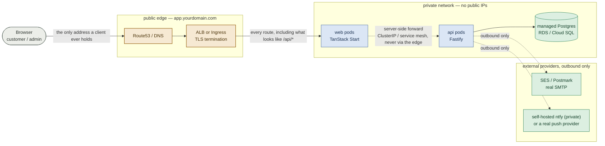

# Production runbook

This repo is **development-only**. A fresh clone runs one command:

```sh
docker compose up -d                  # Postgres, api, web, Mailpit, ntfy; migrations run on api start
docker compose exec api pnpm db:seed  # once, for demo data
```

There is one `compose.yml`, one `Dockerfile` per package (a dev image: full workspace, `tsx`/`vite` watch, source bind-mounted), one committed `.env` per package. No live deployment, no staging, no production images are built anywhere.

Deliberate scope choice (`docs/progress-and-decisions.md` #42). This document answers *"and how would you actually ship this?"*: nothing here is wired, each section is what you'd add.

---

## 1. Build a real runtime image

The dev `Dockerfile`s install devDependencies and run TypeScript source through `tsx`/`vite dev`. Production ships compiled output only. That buys a fail-fast `tsc` gate, a smaller attack surface, fast cold starts, and a deterministic artifact. The steps:

**1. Add the start scripts** (removed from the repo because nothing ran them):

```jsonc
// api/package.json
"start": "node dist/app.js"
// web/package.json
"start": "node server.mjs"
```

**2. Give `web` a real Node server.** `vite build` emits `dist/server/server.js` as a bare Web-standard `fetch` handler with no runtime attached. Run directly with `node`, it exits 0 silently. Wrap it with `srvx` (`pnpm --filter @transaction-dispute-portal/web add srvx`) in `web/server.mjs`:

```js
import { serve } from "srvx";
import handler from "./dist/server/server.js";

serve({ fetch: handler.fetch, port: Number(process.env.PORT ?? 3000), hostname: "0.0.0.0" });
```

Add `server.mjs` to `web/tsconfig.json`'s `include` and to `eslint.config.js`'s ignores (it's plain runtime JS).

**3. Write a multi-stage `api/Dockerfile.prod`:**

```dockerfile
FROM node:24-alpine AS base
RUN corepack enable
WORKDIR /app

FROM base AS build
COPY . .
RUN pnpm install --frozen-lockfile
RUN pnpm --filter @transaction-dispute-portal/api... build

FROM base AS prod-deps
COPY package.json pnpm-workspace.yaml pnpm-lock.yaml ./
COPY api/package.json api/
COPY shared/package.json shared/
RUN pnpm install --frozen-lockfile --prod --filter @transaction-dispute-portal/api...

FROM node:24-alpine AS runtime
ENV NODE_ENV=production
WORKDIR /app
COPY --from=prod-deps /app/node_modules ./node_modules
COPY --from=prod-deps /app/api/node_modules ./api/node_modules
COPY --from=prod-deps /app/shared/node_modules ./shared/node_modules
COPY --from=build /app/shared/package.json ./shared/
COPY --from=build /app/shared/dist ./shared/dist
COPY --from=build /app/api/package.json ./api/
COPY --from=build /app/api/dist ./api/dist
COPY --from=build /app/api/src/database/migrations ./api/src/database/migrations
USER node
WORKDIR /app/api
EXPOSE 8080
CMD ["node", "dist/app.js"]
```

`web/Dockerfile.prod` is the same shape: build with `--filter @transaction-dispute-portal/web...`, copy `web/dist`, `web/server.mjs`, `web/package.json` and the prod `node_modules`, then `CMD ["node", "server.mjs"]`.

Gotchas:
- `shared/dist` imports `zod` at load time, so `shared/node_modules` must ship too, not just `api/node_modules`.
- The web SSR build externalises `react`/`react-dom`, so the web runtime still needs `node_modules` next to `dist/`.
- `drizzle-kit` is a devDependency and never ships. Migrations run with the compiled runner, `node dist/database/migrate.js`, from `/app/api` (it reads `./src/database/migrations`, which is why that folder is copied).
- `VITE_*` values are baked in at `vite build` time, so pass them as build args per environment (§3).

**4. Build and smoke-test locally:**

```sh
docker build -f api/Dockerfile.prod -t dispute-api .
docker run --rm -p 8080:8080 --env-file api/.env --network transaction-dispute-portal_default dispute-api
curl -fsS http://localhost:8080/readyz
```

## 2. Configuration and secrets

Committed env files hold **working local-only fakes** (`docs/progress-and-decisions.md` #34): a throwaway Postgres password, freshly-generated `BETTER_AUTH_SECRET` / `COOKIE_SECRET`, `SMTP_*` pointed at Mailpit, `NTFY_URL=http://ntfy`.

A real deployment:

- injects every value from the orchestrator's secret store (Kubernetes `Secret`, cloud secret manager) — **no `.env` file in the image or the repo**;
- generates fresh `BETTER_AUTH_SECRET` and `COOKIE_SECRET` (32+ bytes each) per environment;
- sets `NODE_ENV=production`, real `API_URL` / `FRONTEND_URL` / `CORS_ORIGIN`;
- keeps a real Gmail App Password (or SES/Postmark credentials) out of git: locally it's an uncommitted edit to `api/.env`, and in production it's an orchestrator secret.

## 3. Networking: a stable public API URL, not a raw infra address

`VITE_API_URL` is a Vite **build-time** var — inlined as a literal string into the client JS bundle, shipped to every browser. `SERVER_API_URL` is read from `process.env` at request time (SSR, Node-only), so it updates on the next server restart with no client involved. The risk is entirely on the `VITE_*` side: if it points at a raw infra address (an ALB's auto-generated DNS name, an ECS task IP) that changes when compute moves, every already-built bundle — including one open in a customer's browser right now — has that address hardcoded and starts failing the moment the old address stops resolving, with no way to fix it short of a fresh build.

**Mitigation: `VITE_API_URL` points at one owned domain behind a reverse proxy / load balancer, never at infrastructure directly.**

| Shape | Indirection | Result |
| --- | --- | --- |
| AWS | Route53 `api.<yourdomain>` → ALB (+ optional CloudFront) → target group → whatever's serving traffic (ECS service, EKS Ingress, EC2 ASG) | Migrating infra (new region, ECS → EKS, new account) just repoints the target group; the built-in URL never changes, no rebuild, no customer-visible break |
| Kubernetes (§8) | `Ingress` is the reverse proxy: `api.<yourdomain>` → `Ingress` → `Service` → live `Deployment` pods | Swapping deployments behind a `Service` is invisible above the `Ingress` |

Same reasoning applies to every other client-facing URL — `FRONTEND_URL` / `CORS_ORIGIN` (§2), `NTFY_URL` (§6) — resolve through an owned domain, never a cloud-generated hostname.

**In production, `api` isn't reachable from the internet at all.** The dev stack publishes every service on its own `localhost` port (no proxy, `docs/progress-and-decisions.md` #65). Production is the opposite: the client holds exactly one address, and everything but `web` sits in a private network with no public IP.



Concretely: `web`'s server gains `/api/*` routes forwarding to `api` over the internal network (`SERVER_API_URL` — the same mechanism SSR loaders already use, extended to cover browser calls too). `VITE_API_URL` becomes a same-origin relative path (`/api`) — nothing bakeable that could go stale — and `api` drops out of the `Ingress`/`ALB` routing table, reachable only inside the cluster. §8's `Ingress`/`Service` shape still applies; `api`'s `Service` is just `ClusterIP`-only, never attached to the `Ingress`.

A real architectural decision, not a tweak: it flips the CORS/cookie model (`docs/progress-and-decisions.md` #51's `withCredentials` + explicit `CORS_ORIGIN` becomes same-origin, cookies can go `SameSite=Strict`, `web`'s forwarding layer relays the session cookie on every proxied call) — worth its own decision entry if actually pursued, not built here.

## 4. Database

- Managed Postgres (RDS / Cloud SQL), not a container. Point `DATABASE_URL` at it.
- Connection pooling: the app opens one pool per instance; put PgBouncer (or the provider's proxy) in front once instance count grows.
- Backups + PITR enabled on the managed instance.

### Migrations as their own gated step

Do **not** run migrations from the app's start command in production (the dev `compose.yml` only does this because it's safe to re-run against a disposable database). A schema change is a reviewed, approved step, independent of the code rollout.

A workflow shape for it: `workflow_dispatch` → `drizzle-kit check` (snapshot/drift guard, no DB needed) → fail if the environment's `DATABASE_URL` secret is missing → `pnpm --filter @transaction-dispute-portal/api migrate`. `concurrency` with `cancel-in-progress: false` so two runs never touch one database at once.

## 5. Email (SMTP) — on the login-critical path

Login is email-OTP (`docs/progress-and-decisions.md` #21, `docs/backend-service.md` §2): every sign-in sends a code over SMTP, so outbound email is a hard dependency, not best-effort.

- Real transactional provider (SES, Postmark, SendGrid), authenticated domain (SPF/DKIM/DMARC).
- `sendEmail` currently swallows transport errors (`docs/progress-and-decisions.md` #31) — in production, surface them: alert on send-failure rate, and consider a fallback provider.
- Rate-limit knobs are `RATE_LIMIT_MAX` / `RATE_LIMIT_WINDOW` (global) and `OTP.MAX_ATTEMPTS` (per-OTP, shared constant); the auth routes inherit the global window.

## 6. Notifications (ntfy)

Dispute-status changes publish to a per-user ntfy topic (`docs/dev-tools.md`). This is explicitly a *simulated* notification channel — not real push/SMS.

- Dev: the `ntfy` service in `compose.yml`, web UI on `localhost:8090`.
- Production: either run a self-hosted ntfy instance and set `NTFY_URL` to it, or accept that this stays a demo affordance. It must never carry auth credentials (OTP codes) — see the scope boundary in `docs/dev-tools.md`.

## 7. CI/CD

**What exists (CI):** `.github/workflows/build.yml` runs on every push and PR. It does lint, typecheck, build, and the test suites against real Postgres + Mailpit service containers, then a `docker compose up --wait` smoke test that hits `/healthz` and `/` and seeds.

**What to add (CD), step by step:**

1. **Make CI reusable.** Add `workflow_call:` to `build.yml`'s `on:`, so a deploy workflow can call it and get one connected job graph.
2. **Create GitHub Environments** (repo Settings → Environments): `staging` (no gate) and `production` (required reviewers). Put each environment's secrets there: `DATABASE_URL`, `BETTER_AUTH_SECRET`, `COOKIE_SECRET`, `SMTP_*`, and cluster credentials. Reviewer gates can't be expressed in YAML, so this step is manual.
3. **Add `.github/workflows/deploy.yml`:**

```yaml
name: Deploy
on:
  push:
    branches: [main]
permissions:
  contents: read
  packages: write
jobs:
  checks:
    uses: ./.github/workflows/build.yml
  images:
    needs: checks
    runs-on: ubuntu-latest
    strategy:
      matrix:
        app: [api, web]
    steps:
      - uses: actions/checkout@v4
      - uses: docker/login-action@v3
        with:
          registry: ghcr.io
          username: ${{ github.actor }}
          password: ${{ secrets.GITHUB_TOKEN }}
      - run: |
          IMAGE=ghcr.io/${{ github.repository }}-${{ matrix.app }}
          docker build -f ${{ matrix.app }}/Dockerfile.prod -t $IMAGE:sha-${{ github.sha }} -t $IMAGE:latest .
          docker push --all-tags $IMAGE
  staging:
    needs: images
    environment: staging
    runs-on: ubuntu-latest
    steps:
      - run: echo "kubectl set image ... :sha-${{ github.sha }}"
  production:
    needs: staging
    environment: production
    runs-on: ubuntu-latest
    steps:
      - run: echo "kubectl set image ... :sha-${{ github.sha }}"
```

   Build tags explicitly from `github.sha`. Don't use `docker/metadata-action`: its `context: git` can't introspect the detached-HEAD checkout Actions uses.
4. **Add `.github/workflows/migrate.yml`,** separate and manually triggered, because a schema change is a reviewed step, not a side effect of a deploy: `on: workflow_dispatch` with an environment input → `drizzle-kit check` → fail if the environment's `DATABASE_URL` is missing → `node dist/database/migrate.js`. Set `concurrency: { group: migrate-${{ inputs.environment }}, cancel-in-progress: false }`, so two runs never touch one database at once. Run it before the matching deploy.
5. **Replace the `echo` deploy steps** with the real rollout for your platform (`kubectl apply`/Helm/Argo for §8, or `aws ecs update-service`).

## 8. Kubernetes

`k8s/` manifests are not in the repo yet (CLAUDE.md lists them as a bonus). A minimal set:

- `Deployment` for api and web, `Service` each, `Ingress` with TLS.
- Probes wired to the endpoints that exist for exactly this: `livenessProbe` → `GET /healthz`, `readinessProbe` → `GET /readyz` (the latter does a 2s `select 1`, so it fails the pod out of rotation when the DB is unreachable — `docs/backend-service.md`).
- `HorizontalPodAutoscaler` on CPU / RPS.
- Secrets from a `Secret` (or External Secrets Operator), config from a `ConfigMap`.
- A one-shot `Job` (or Argo pre-sync hook) for the migration step.

## 9. Observability and the load-test number

- Logs: structured JSON (Pino) to stdout, shipped by the platform. The `correlationId` (from `x-correlation-id` / `x-request-id`, echoed on every response) is the request-tracing key.
- Metrics: add a `/metrics` endpoint (prom-client) — request rate, p50/p95/p99 latency, error rate, pool saturation.
- The DoD asks for one load-test number (p95 / RPS) in the README: run `k6` / `autocannon` against `GET /v1/transactions` on the seeded dataset (~4.6k rows, pagination + indexes exercised) and record it.

## 10. Pre-ship checklist

- [ ] Multi-stage images build and run (`node dist/app.js`), non-root, no dev deps / source
- [ ] All secrets injected by the orchestrator; none in the image or git
- [ ] Fresh `BETTER_AUTH_SECRET` / `COOKIE_SECRET` per environment
- [ ] Managed Postgres with backups; `DATABASE_URL` points at it; pooling in front if multi-instance
- [ ] Migration workflow run and green before the app rollout
- [ ] Real SMTP with an authenticated domain; send-failure alerting
- [ ] Probes green (`/healthz`, `/readyz`), HPA configured
- [ ] Logs + metrics flowing; load-test number captured
